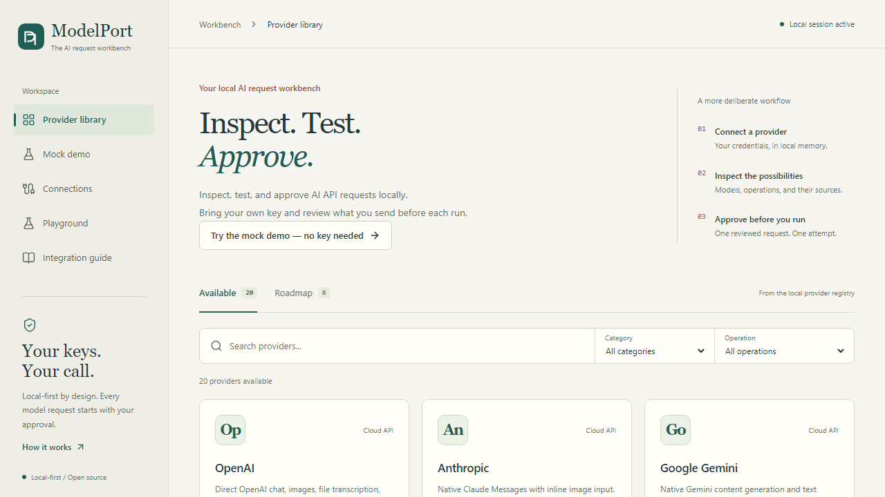

# ModelPort

A local workbench to inspect, test, and approve AI API requests.

ModelPort helps developers prototype AI integrations: connect your provider, inspect model capabilities, review what will be sent, and approve one request. Bring your own credentials and inspect the result before taking the request into your project. A server-side TypeScript SDK and a coding-agent skill support that workflow.

Start with the **Mock demo** in the app: no API key or provider calls, just a clearly labeled simulation. Follow [your first reviewed request](docs/GETTING-STARTED.md) for source installation and a real-provider walkthrough.



## What You Can Do

- Inspect provider metadata and capability evidence before sending a prompt.
- Review the destination base URL, model, parameters, complete text input, and media details before approving a single attempt.
- Inspect returned text/media, elapsed time, and usage where provided.
- Copy request-specific TypeScript preparation code or download a JSON run record. Prompt and response content are omitted by default; inclusion requires a separate opt-in. Credentials, internal IDs and media bytes are excluded.

Use ModelPort for deliberate integration experiments on your workstation. Production automation, hosted team administration, and durable experiment history are outside the current scope.

**V1 preview:** the SDK, adapters, workbench, and skill are implemented, with offline contract and browser tests. This is not a production security certification, a published npm package announcement, or a claim that live provider calls have passed. The [provider matrix](docs/PROVIDERS.md) describes adapter coverage; the registry in `packages/core` is the runtime source of truth.

## Start Locally

Requirements: Node.js **22.12 or newer**, npm, and this source checkout. Run commands from the repository root. Do not add provider keys to project files or an `.env` file.

```sh
npm ci
npm run dev
```

Open **http://127.0.0.1:5173**. The development API listens on `127.0.0.1:8787`; Vite proxies `/api` to it. Use the displayed loopback address rather than a LAN address or a public tunnel.

For a production build served by a single local process:

```sh
npm run build
npm start
```

Open **http://127.0.0.1:8787**. Here, "production build" describes the build mode, not support for internet-facing or multi-user hosting.

1. Select a provider and connect with a key entered in the workbench. Local providers can have different authentication requirements.
2. Read the verification message and catalog warnings. Metadata authentication does not prove credits, model access, or successful inference.
3. Select an operation and a model with known capabilities. If metadata is incomplete, consult the provider documentation before making an explicit human capability declaration.
4. Enter text or an allowed local media file. Review the exact provider, model, operation, input, limits, and billing notice.
5. Approve that request to execute it once. Editing the request or switching the model requires a new approval.
6. Disconnect when finished. Disconnecting removes the managed credential; restarting the API clears its in-memory connections and approvals. Closing a tab alone is not credential deletion.

After a successful response, expand **Use this request in your project** for code and export. Review the opt-in content setting and all exported metadata before sharing.

Connecting, refreshing metadata, declaring a capability, changing selection, and preparing a request do not run inference. Metadata requests still contact the selected service; this is not a universal guarantee of a zero-dollar provider charge.

## Operations

| SDK operation | Purpose | Input |
| --- | --- | --- |
| `text` | Text generation | Text |
| `vision` | Image understanding | Text and an inline image |
| `image` | Image generation | Text |
| `stt` | Speech-to-text | A local audio file |
| `tts` | Text-to-speech | Text and a voice where required |
| `embedding` | A text embedding | Text |

These are six operations across the registry, **not six operations on every provider or model**. Native APIs and compatible APIs have different capabilities and response shapes. A provider marked `ready` has an adapter; it does not mean every account or model is usable. A `planned` entry cannot execute.

The [provider matrix](docs/PROVIDERS.md) owns the detailed coverage and source links. Enterprise AWS Bedrock, Azure and Vertex integrations, and providers requiring additional specialist job handling, remain explicit roadmap entries where the registry says `planned`.

V1 does not provide realtime audio, microphone streaming, streamed generation, tool execution, remote input URLs, arbitrary model downloads, fine-tuning, or asynchronous specialist image/video jobs. An unsupported ModelPort operation is not a claim that the vendor lacks that operation.

## Limits And Data

| Boundary | V1 limit |
| --- | --- |
| Text input | 16,000 characters |
| Output token setting | Default 512; maximum 4,096 for `text` and `vision` only |
| Inline media input | 4 MiB of decoded bytes |
| Image dimensions | At most 8,192 pixels per side and 16,777,216 pixels total |
| Upstream response | 16 MiB |
| Approval lifetime | 5 minutes; one use |
| Pending approvals | At most 8, with 12 MiB total retained input strings |
| Connections | At most 16 per SDK instance |
| Inference concurrency | One request at a time per SDK instance |

Accepted input MIME types are `image/png`, `image/jpeg`, `image/webp`, `audio/mpeg`, `audio/wav`, `audio/ogg`, `audio/webm`, and `audio/flac`. Animated PNG/WebP is rejected. A provider or operation may accept a smaller subset. Base64 is an encoding, not validation. Media checks cover allowed types, size, signatures, and image dimension headers; they are **not antivirus scanning or complete codec validation**.

Only `vision` and `stt` accept `media`. Transcription omits `text`; the other operations require it. Only `tts` accepts `voice`, and only `text`/`vision` accept `maxOutputTokens`. Unsupported fields are rejected rather than silently ignored.

Credentials entered through the app are retained in the Node process, not browser storage or a credential database. The browser necessarily handles the value transiently during entry. Prompt text and media are transmitted to the selected provider only when the corresponding inference is approved. Results can remain in the current UI. Provider retention and billing policies still apply.

Loopback does not prove offline processing: a local service may route a selected model to a cloud provider. Local execution can also consume substantial CPU/GPU resources.

There are no automatic inference retries, fallback models, background titles, or dollar-budget guarantees. A timeout or lost response can mean the provider already started or completed billable work. A new attempt needs a new approval. Cancelling a pending approval prevents its later execution; it is not a refund or a guarantee that already-dispatched work stops.

## Use The SDK

`@modelport/core` is the server-side workspace package in this source tree. The workspace install resolves it locally; do not assume a package with that name on a public registry is this project. Publishing the SDK is a separate owner-controlled step.

Keep a `ModelPort` instance in a trusted server process. Importing it into a browser, edge environment without the guarded Node transport, or untrusted agent runtime is not a supported security boundary.

### Prepare For Review

This example defines server functions; it does not automatically connect or execute a model. `apiKey` must come from trusted server-side input, not a literal in source code. The host must authorize access to connections and derive `sessionScope` from its authenticated session rather than accepting a client-supplied scope.

```ts
import { ModelPort, type RunInput } from '@modelport/core';

const port = new ModelPort();

export async function connectProvider(apiKey: string) {
  if (!apiKey.trim()) throw new Error('A server-side credential is required.');
  return port.connect({ providerId: 'openai', apiKey });
}

export function prepareForReview(input: RunInput, sessionScope: string) {
  return port.prepare(input, { scope: sessionScope });
}
```

Present the returned `Approval` to the human and wait for a separate, explicit decision. Preserve its provider, model, operation, content preview, media information, expiry, and billing warning. Do not execute in the same automatic code path as `prepareForReview`.

### After Human Approval

The following is an SDK call site, **not a complete HTTP authorization handler**. Invoke it only after the host authenticates the approving human, verifies session/CSRF requirements, and confirms the approval belongs to that session. An agent, webhook, or arbitrary request body must not be able to call it as an approver.

```ts
export async function executeAfterHumanApproval(
  approvalId: string,
  sessionScope: string,
) {
  return port.execute(approvalId, { consent: true, scope: sessionScope });
}
```

`consent: true` alone does not establish human authorization. The protection is the host's authenticated decision together with the SDK's immutable, scoped, expiring, single-use stored approval. Scope isolates approvals; it does not implement user authentication, connection ownership, or hosted multi-tenancy for an embedding application.

### Public Surface

| Method | Role |
| --- | --- |
| `connect({ providerId, apiKey?, baseUrl?, workspaceId?, name? })` | Connect and inspect metadata; `baseUrl` is for approved local profiles only. `workspaceId` is for Anthropic keys that require it. |
| `getConnections()` | Read credential-free connection summaries. |
| `refresh(connectionId)` | Refresh connection metadata and models without inference; a successful refresh invalidates pending approvals for the connection. |
| `declareModel(connectionId, { id, operations })` | Record a human declaration, not a successful model test; invalidate the connection's pending approvals. |
| `prepare(input, { scope? })` | Synchronously validate and store a pending approval. |
| `listApprovals({ scope? })` | List pending approvals in the requested scope. |
| `execute(approvalId, { consent: true, scope? })` | Consume the stored approval and attempt inference once. |
| `cancel(approvalId, { scope? })` | Discard a pending approval. |
| `disconnect(connectionId)` | Remove the managed connection, its credential and its pending approvals. |
| `dispose()` | Clear managed connections/approvals and close the instance; it cannot be reused. |

`RunInput`, `Approval`, `RunResult`, and the registry types are defined in [the core contracts](packages/core/src/types.ts). SDK consumers must apply the same transport, credential, approval and output-rendering boundaries as the workbench; see [SECURITY.md](SECURITY.md).

## Coding-Agent Skill

The portable skill is [skills/modelport/SKILL.md](skills/modelport/SKILL.md), with progressive-disclosure material in `references/`. It teaches task/modality selection, server-side credentials, capability evidence, separate human approval, and offline verification. It grants no execution authority.

Use your agent's documented project-level skill loader with `skills/modelport` as the source, retaining its `references` directory. No global agent configuration is changed by ModelPort.

An optional installer is the independently maintained [Agent Skills CLI](https://github.com/vercel-labs/skills). Its current documented requirement is Node 22.20 or newer, which is higher than ModelPort's minimum. If you choose to install and trust that CLI, its documented local-source syntax from this checkout is:

```sh
npx skills add ./skills/modelport --skill modelport
```

Review the CLI's package/version, telemetry settings, chosen agent and destination before confirming installation. This command downloads/runs a separate tool and writes skill configuration; it is not part of ModelPort setup or a model test. Agent-specific discovery behavior varies.

## Verify Offline

```sh
npm run check
npx playwright install chromium
npm run test:e2e
```

`check` runs type checking (including test fixtures), unit tests and the production build. Playwright boots the real local server, then tests provider workflows with mocked application API responses rather than provider credentials. Browser installation downloads Chromium; it is not an inference call. Linux CI additionally uses Playwright's `--with-deps` option to install browser system dependencies.

These checks validate local code and contracts, not live provider compatibility, credits or a security certification. Report the exact checks run and failures; do not turn a fixture-based test into a "live verified" badge. See [CONTRIBUTING.md](CONTRIBUTING.md) for provider and security test expectations.

## Project Map

| Path | Responsibility |
| --- | --- |
| `packages/core` | Registry, adapters, validation, guarded transport and approvals |
| `apps/server` | Fastify API, local session/CSRF boundary and static app serving |
| `apps/web` | React workbench |
| `skills/modelport` | Coding-agent skill and references |
| [docs/PROVIDERS.md](docs/PROVIDERS.md) | Provider coverage and evidence |
| [docs/GETTING-STARTED.md](docs/GETTING-STARTED.md) | No-key demo and first real request |
| [docs/DEPENDENCY-LICENSES.md](docs/DEPENDENCY-LICENSES.md) | Generated inventory of declared dependency licenses |

## Security And Contribution

Read [SECURITY.md](SECURITY.md) before using real credentials or discussing a vulnerability. This is a trusted single-user local application, not a hardened public gateway. Do not expose it through a reverse proxy or tunnel and assume it has hosted authentication or tenant isolation.

Contributions follow [CONTRIBUTING.md](CONTRIBUTING.md) and the [Code of Conduct](CODE_OF_CONDUCT.md). Reports, fixtures and screenshots must not contain API keys, account identifiers, private prompts, recordings or sensitive media.

## Publication

The source repository is [ManojAbhiram/ModelPort](https://github.com/ManojAbhiram/ModelPort). This preview does not announce a public npm release.

Publication is an explicit maintainer action. Review the source/history for secrets and third-party material, run the checks, and establish monitored security/community reporting. Configure private vulnerability reporting and branch protections where available, and review actual CI results and dependency alerts. Publishing an npm package is a separate action; repository workflows do not publish or deploy automatically.

## License

Original ModelPort code and documentation are [MIT licensed](LICENSE), copyright 2026 ModelPort contributors. Upstream libraries retain their own licenses. Provider services, model weights, voice rights, and generated-content terms are not licensed by this repository. Research references are not endorsements, forks, copied UI assets, or claims of affiliation.

The maintainer must confirm ownership and attribution before publication. Run `npm run licenses:report` to refresh the declared dependency-license inventory and `npm run package:preview` to inspect SDK packaging without publishing. The SDK includes its own copy of the root MIT license. Review exact dependency license texts and distribution obligations; an inventory is not legal clearance.
