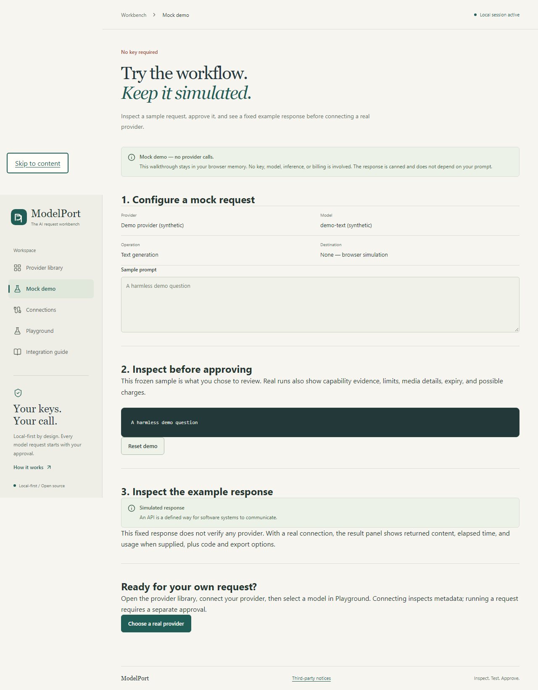

# Your First Reviewed AI Request

ModelPort is a local workbench to inspect, test, and approve AI API requests. Use it when prototyping an integration and checking what will be sent to a model. The SDK and coding-agent skill support taking that workflow into your project.

## Install from source

Use Node.js 22.12 or newer and npm. Download a reviewed source checkout or release archive, then run these commands from its root:

```sh
npm ci
npm run build
npm start
```

Open http://127.0.0.1:8787. For development, use `npm run dev` and http://127.0.0.1:5173 instead. Keep the server on loopback.

## Try without a key

Choose **Mock demo** in the sidebar, or **Try the mock demo** on the provider library. Edit the sample prompt, review it, and choose **Approve mock response**. This is a browser-only simulation with a fixed response, no inference, and no provider contact. It does not test provider compatibility. The app still loads its local session and provider registry from your local server.



## Connect and inspect

1. Open **Provider library** and choose an available provider. For a first text request, start with an existing OpenAI, Anthropic, Gemini, or Ollama account/installation. These are adapter examples, not a claim of live verification.
2. Enter your key in the connection dialog; do not add it to a project file. Read the metadata verification message.
3. Open **Playground**, choose the connection, text generation, and a compatible model. If capabilities are unknown, consult official provider documentation before making a deliberate declaration in Connections.
4. Enter a short, non-sensitive prompt such as “Explain what an API is in one sentence.” Set a small output limit; it is not a dollar budget.
5. Choose **Review request**. Inspect the provider, destination base URL, model, capability source, parameters, complete text, and any media details. Scroll through long text. Nothing has run yet.
6. Read the possible-charge notice, check the consent box, and choose **Approve & run** only when you want to send that request.
7. Inspect the response, duration, and provider-reported token usage when available. Check your provider account for actual charges.

Changing inputs requires a new approval. Failures and timeouts may still be billed; there is no automatic retry. Local endpoints may forward requests to cloud services.

## Take the request into your project

After a successful response, expand **Use this request in your project**. Copy the TypeScript preparation function or download a JSON run record. Default artifacts omit prompt and response content; the code uses an input placeholder. A separate checkbox opts into including text and, in the record, response embeddings. Media bytes, credentials, and internal IDs are excluded. Metadata such as model names and voice IDs is still included; review before sharing.

The code prepares an approval using an existing trusted server connection. Your host must display it to an authenticated human and execute in a separate authorized action. It is not an automatic production inference integration.

## Finish

Disconnect to remove the managed credential. Restarting the server clears its in-memory connections and approvals; closing the browser tab does not delete a connection. Results are not a durable history. See SECURITY.md for the full boundary.

## A 60-second demonstration

Record only synthetic data: 0–10 seconds, open the library; 10–25, enter the mock demo; 25–40, inspect and approve the sample; 40–50, show the simulated response; 50–60, explain that real providers need your own key and a separate approval. Label the recording “mock demo”; never show credentials or imply live results.
